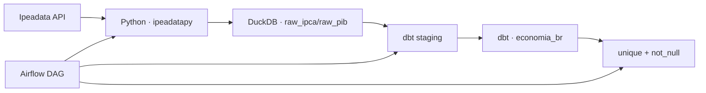

# Analytics Engineering com dbt e dados do IPEA

Projeto local de ELT para ingerir duas séries econômicas do Ipeadata em DuckDB e transformá-las com dbt Core. Um DAG do Airflow versiona a ordem ingestão → modelos → testes.

**Estado:** protótipo funcional documentado por artefatos dbt versionados. O `run_results.json` registra três testes aprovados em 19 de maio de 2026, mas a auditoria atual não reexecutou o fluxo porque Docker, dbt e as dependências de ingestão não estão instalados neste ambiente.

## Fluxo



O mart faz um `INNER JOIN` mensal entre IPCA e PIB e calcula uma variação do índice IPCA com `LAG`. O resultado contém apenas competências presentes nas duas fontes.

## Stack

| Responsabilidade | Tecnologia |
| --- | --- |
| ingestão | Python + `ipeadatapy` |
| armazenamento | DuckDB |
| transformação e testes | dbt Core + dbt-duckdb |
| orquestração | Apache Airflow 2.9.1 via Docker Compose |

## Executar com Docker

Pré-requisito: Docker com Compose.

```bash
docker compose up airflow-standalone
```

O Compose monta `dags/`, `src/`, `dbt_project/` e `data/` e instala `dbt-duckdb`, `ipeadatapy`, `pandas` e `duckdb` no container. A interface do Airflow fica em `http://localhost:8080`, com as credenciais didáticas definidas no Compose.

Também é possível executar manualmente dentro de um ambiente com as dependências instaladas:

```bash
python src/ingestion/ingest_ipea.py
cd dbt_project
dbt run --profiles-dir .
dbt test --profiles-dir .
dbt docs generate --profiles-dir .
dbt docs serve --profiles-dir .
```

O arquivo de perfil já está versionado em `dbt_project/profiles.yml`; não existe `profiles.yml.example`.

## Evidências e testes

O projeto possui testes dbt de unicidade e não nulidade em `economia_br`. Os artefatos atuais registram:

- `not_null` em `mes_referencia`;
- `not_null` em `pib_milhoes_brl`;
- `unique` em `mes_referencia`.

Esses artefatos são históricos de uma execução anterior, não substituem um novo `dbt test`.

## Limitações

- não há `requirements.txt`, `pyproject.toml` ou lockfile para execução fora do container;
- a ingestão captura exceções por série e pode terminar com sucesso mesmo se uma fonte falhar;
- as tabelas raw são recriadas, sem histórico de cargas ou metadados de extração;
- não há teste de fonte, freshness, valores aceitos ou reconciliação de contagens;
- `dbt_project/target/` e `.user.yml` estão versionados e deveriam ser tratados como artefatos locais;
- o agendamento presume uma data fixa de divulgação do IPCA que deve ser validada operacionalmente;
- não há CI.

Roadmap recomendado: manifesto de dependências, falha explícita na ingestão, testes de fonte/recência e remoção dos artefatos locais do controle de versão.
