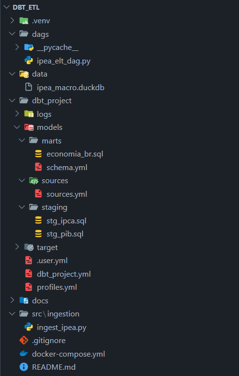

# 04 · Analytics Engineering com dbt

> Transformação pertence a quem conhece o negócio. dbt traz versionamento, testes e documentação para a camada que mais importa.

## Problema

SQL solto em scripts sem versionamento, sem teste e sem documentação. Qualquer pessoa que sai da empresa leva o conhecimento embora. dbt resolve isso tratando transformação como software.

## Solução

Stack ELT completa com dados econômicos do IPEA: ingestão bruta → staging limpo → marts de negócio, tudo documentado com linhagem automática e testes em cada modelo.

```
IPEA API (raw)
    └── DuckDB (raw layer)
        └── dbt staging models
            └── dbt mart models
                └── dbt docs (lineage + catalog)
                    └── Airflow DAG (trigger)
```

## Dataset

**IPEA Data — Ipeadata**
Séries econômicas brasileiras: IPCA, PIB, câmbio, desemprego, etc.
Fonte: http://www.ipeadata.gov.br/

## Stack

| Camada | Tecnologia |
|---|---|
| Ingestão | Python + ipeadatapy |
| Storage | DuckDB |
| Transformação | dbt Core |
| Orquestração | Apache Airflow |
| Documentação | dbt docs |
| Testes | dbt tests + dbt-expectations |

## Estrutura



## Como rodar

```bash
# 1. Ingerir dados IPEA
python src/ingestion/ingest_ipea.py

# 2. Setup dbt
cp dbt_project/profiles.yml.example ~/.dbt/profiles.yml
cd dbt_project && dbt deps

# 3. Rodar modelos
dbt run

# 4. Rodar testes
dbt test

# 5. Gerar e servir documentação
dbt docs generate && dbt docs serve
```

## O que este projeto demonstra

- Arquitetura em camadas: raw → staging → marts
- Testes de qualidade embutidos nos modelos
- Documentação e linhagem automáticas
- dbt como "versão de verdade" da transformação
